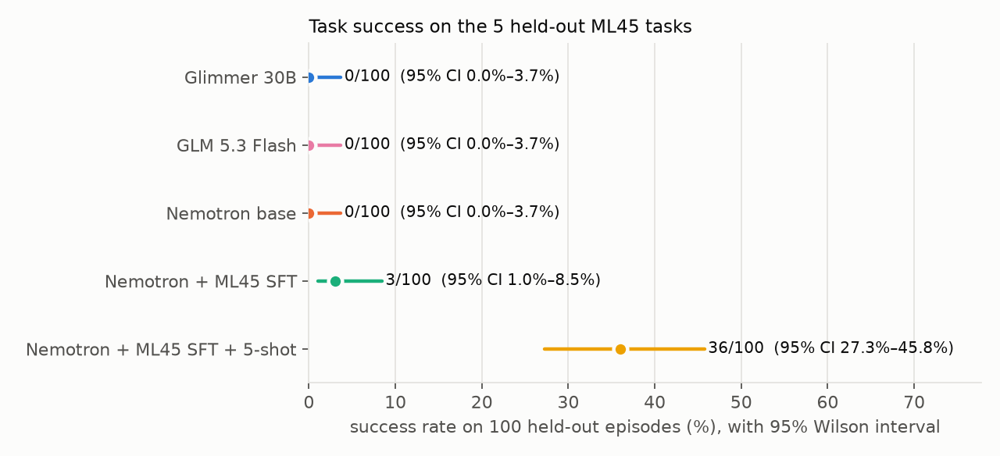
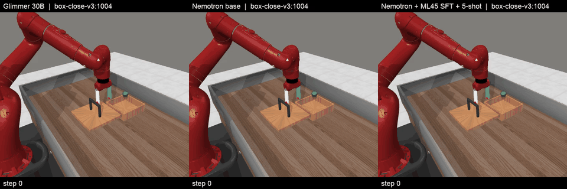
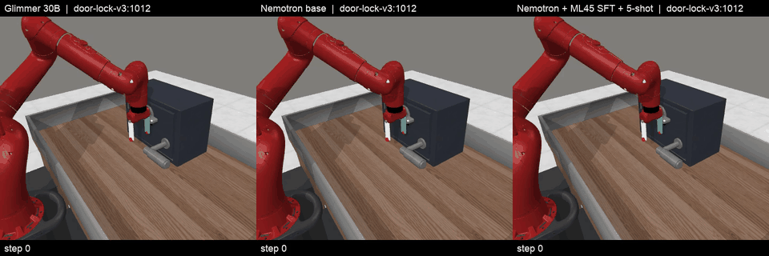
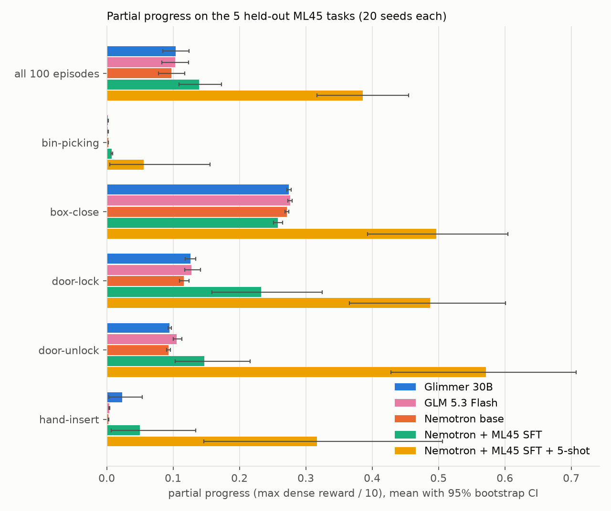
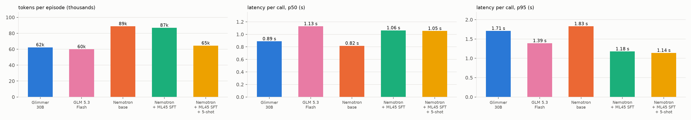

# robot_task_firework: an ML45 held-out benchmark for VLM robot policies

Can a vision-language model drive a robot arm on manipulation tasks it was never trained on?
Models control a simulated Sawyer arm in [Meta-World](https://arxiv.org/abs/1910.10897) from one
camera image plus the end-effector state, and reply with low-level actions. Training and inference
run on Fireworks; the simulator runs locally.

## Protocol (frozen in `ml45bench/spec.py` and `benchmark/manifest.json`)

| | |
|---|---|
| Split | Meta-World **ML45**: train on 45 tasks, test on 5 held-out tasks: `bin-picking`, `box-close`, `door-lock`, `door-unlock`, `hand-insert` |
| Test set | 5 tasks × 20 seeds (1000–1019) = **100 episodes**, each a different scene (object and goal positions logged in the manifest) |
| Episode | ≤ 500 env steps (MetaWorld `max_path_length`); success = `info["success"]` at any step |
| Observation | `corner2` camera at the LeRobot MT50 pose, 480 px → 256 px bicubic → JPEG q85, plus `End effector: x,y,z` and `Gripper: open/closed` (`obs[3] < 0.5`) |
| Prompt | Task text from `lerobot/metaworld_mt50` plus `Goal: <name>`. The goal is named but its location is never given |
| Action | 3 actions per call, each `dx,dy,dz,grip`; xyz ∈ −10..10 (10 = 1 cm), grip ∈ −2..2, executed open-loop |
| Decoding | same for every model: temperature 0, top_p 1, seed 0, max_tokens 64, GBNF grammar for exactly 3 actions, reasoning off |
| Invalid reply | the valid actions in it are executed, padded with no-ops; counted in `invalid_reply_rate` |
| Reference | MetaWorld's scripted expert solves 100/100 episodes, also through our quantized action format (ceiling) |

Replicability:
- The manifest freezes each episode's initial scene and the sha256 of the first image. The runner checks both before every episode, so a different MuJoCo, MetaWorld or Pillow build that would change the episodes is caught.
- `manifest --check` rebuilds the manifest and compares.
- Every model call is logged: image hash, prompt, raw reply, parsed actions, latency and tokens.
- `run --replay` re-simulates a run from its log without the API and checks every image and outcome.
- Dependencies are pinned in `uv.lock`.
- API outputs at temperature 0 are not guaranteed bit-identical across calls, which is why the log, not a re-query, is the record.

## Models (`benchmark/models.json`)

| key | model | Fireworks deployment shape |
|---|---|---|
| `glimmer-30b` | Muse Glimmer 30B (Meta) | 1× H200 |
| `qwen3p8-27b` | Qwen3.8 27B | 1× H100 |
| `gemma4-26b-a4b` | Gemma 4 26B A4B IT | 4× B200 |
| `nemotron-super-vl` | NVIDIA Nemotron 3.5 Super VL 120B A12B BF16 | 4× B300 |
| `nemotron-ml45-sft` | Nemotron + LoRA SFT on the 45 training tasks (zero-shot on test) | 4× B300, live-merged |
| `nemotron-ml45-5shot` | the above + LoRA warm-start on 5 demos per test task | 4× B300, live-merged |

## Results (100 held-out episodes, same scenes for every model)



| model | success (95% Wilson CI) | progress (95% CI) | invalid replies | tokens / episode | latency / call p50, p95 |
|---|---|---|---|---|---|
| Muse Glimmer 30B (Meta), base | 0/100 (0–3.7%) | 0.104 (0.085–0.124) | 0% | 62k | 0.89 s, 1.71 s |
| GLM 5.3 Flash, base (serverless) | 0/100 (0–3.7%) | 0.103 (0.084–0.124) | 0% | 60k | 1.13 s, 1.39 s |
| Nemotron 3.5 Super VL 120B A12B, base | 0/100 (0–3.7%) | 0.097 (0.078–0.117) | 0% | 89k | 0.82 s, 1.83 s |
| Nemotron + LoRA SFT on ML45 train (45 tasks) | 3/100 (1.0–8.5%) | 0.139 (0.109–0.173) | 0% | 87k | 1.06 s, 1.18 s |
| **Nemotron + SFT + 5-shot** (5 demos per test task) | **36/100 (27.3–45.8%)** | **0.386 (0.318–0.457)** | 0% | 65k | 1.05 s, 1.14 s |

Per task (successes out of 20): 5-shot solves bin-picking 1, box-close 10, door-lock 9, door-unlock 12, hand-insert 4.
The ML45 SFT model solves door-lock 2 and door-unlock 1; the base models (Glimmer, GLM 5.3 Flash, Nemotron) solve none.

Paired comparisons on the same 100 episodes (exact McNemar, paired bootstrap 95% CI):
- 5-shot vs Nemotron base: +36 points (CI +27 to +45), 36 episodes only 5-shot solves, 0 the other way, p < 0.001. Same against Glimmer and GLM 5.3 Flash.
- 5-shot vs ML45 SFT: +33 points (CI +23 to +43), discordant 35 / 2, p < 0.001.
- ML45 SFT vs Nemotron base: +3 points, discordant 3 / 0, p = 0.25 (not significant on success). Progress is significantly higher: +0.042 (CI +0.017 to +0.072), better on 70 of 100 episodes.
- 5 eval scenes start within 1 cm of a 5-shot training demo (the tasks randomize over a small area; eval scenes are themselves 0.5–1.4 cm apart). Excluding them, 5-shot scores 33/95 = 34.7% (CI 25.9–44.7%).

### Same held-out episode, three models

Left to right: Muse Glimmer 30B (base), Nemotron Super VL (base), Nemotron + ML45 SFT + 5-shot. Re-simulated from the logged actions,
at 10 fps (every 2nd step). Each clip ends 2 s after the 5-shot success; the base models run on to 500 steps without succeeding.

**box-close, seed 1004** (5-shot succeeds at step 114)



**door-lock, seed 1012** (5-shot succeeds at step 57)



Full-length videos (20 fps, every step), per model and side by side:

| episode | Glimmer 30B (base) | Nemotron (base) | Nemotron + SFT + 5-shot | side by side |
|---|---|---|---|---|
| box-close 1004 | [mp4](docs/videos/glimmer-30b__box-close-v3_1004.mp4) | [mp4](docs/videos/nemotron-super-vl__box-close-v3_1004.mp4) | [mp4](docs/videos/nemotron-ml45-5shot__box-close-v3_1004.mp4) | [mp4](docs/videos/side_by_side__box-close-v3_1004.mp4) |
| door-lock 1012 | [mp4](docs/videos/glimmer-30b__door-lock-v3_1012.mp4) | [mp4](docs/videos/nemotron-super-vl__door-lock-v3_1012.mp4) | [mp4](docs/videos/nemotron-ml45-5shot__door-lock-v3_1012.mp4) | [mp4](docs/videos/side_by_side__door-lock-v3_1012.mp4) |





Notes:
- Every run replays exactly from its logs (`REPLAY MATCH`).
- Training on Fireworks: ML45 SFT is LoRA rank 64, 1 epoch, 17,336 rows (45 tasks × 20 demos, every 4th frame), $28.35. 5-shot warm-starts from it: rank 64, 3 epochs, 1,018 rows (5 test tasks × 5 demos, every 2nd frame), $5.05. The datasets are read from a GCS bucket (`ml45bench/sft.py`, `ml45bench/build_sft_parquet.py`).
- GLM 5.3 Flash: GLM-5.3 itself does not accept images on Fireworks, so the image-capable Flash model is used. Every way to turn its thinking off returns HTTP 400 ("Invalid image or video input"), so it runs with `reasoning_effort: "low"` (like Glimmer). The grammar still limits the output to exactly 3 actions (~24 tokens), but Fireworks returns that output as `reasoning_content` with `content` empty, so for this model only the answer is read from `reasoning_content` when `content` is empty (`answer_fallback` in `models.json`). Serverless, about $1 for the 100 episodes.
- Qwen3.8 and Gemma 4 are configured in `models.json` but were not run.
- Figures: `uv run --locked --with matplotlib python -m ml45bench.plots runs/<run> ...`. Videos (re-simulated from the logs, no API): `uv run --locked --with matplotlib python -m ml45bench.video --episodes box-close-v3:1004 door-lock-v3:1012 --runs runs/glimmer-30b runs/nemotron-super-vl runs/nemotron-ml45-5shot`.

## Usage

```bash
uv sync --locked
echo 'FIREWORK_API=<your key>' > .env                      # git-ignored

uv run --locked python -m ml45bench.manifest --check       # same episodes on this machine?
uv run --locked python -m ml45bench.deploy up qwen3p8-27b  # on-demand deployment (scales to zero after 15 min idle)
uv run --locked python -m ml45bench.deploy probe qwen3p8-27b
uv run --locked python -m ml45bench.run --model qwen3p8-27b --concurrency 10
uv run --locked python -m ml45bench.run --replay runs/qwen3p8-27b
uv run --locked python -m ml45bench.report runs/*/                # Wilson CIs, paired McNemar + bootstrap
uv run --locked python -m ml45bench.deploy down ml45-qwen3p8-27b
```

Metrics per model:
- success rate (95% Wilson CI), overall and per task
- partial progress: max dense reward / 10, and grasp rate
- invalid-reply rate
- tokens per episode and per success
- per-call latency p50/p95, and model time per episode

Models are compared pairwise on the same 100 episodes with an exact McNemar test and a paired-bootstrap CI.
